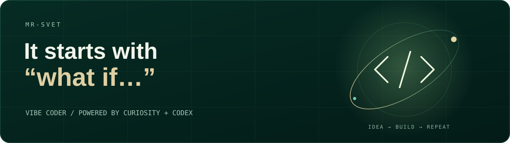

<p align="center">
  
</p>

### Somewhere between “what if…” and the first commit

I’m **Mr. Svetlachok**, a vibe coder. I turn ideas into things you can actually use: **websites, apps, bots**, and whatever I haven’t found a name for yet.

**Codex** is my go-to tool. I set the direction, work out the logic, experiment with the interface, and keep tweaking until it feels like *“yep, that’s what I had in mind.”*

I like building tools for my own needs. If something’s missing, that’s reason enough to start a new project.

---

> This is where my experiments live. Some start with “I’ll just build a quick little thing” and somehow end up needing a database.

```text
$ build "a quick little thing"
✓ idea
✓ first commit
+ database has entered the chat
```
